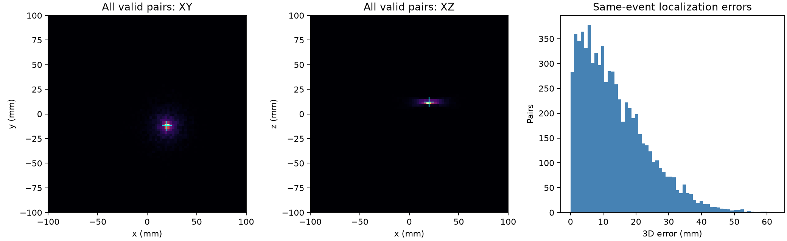
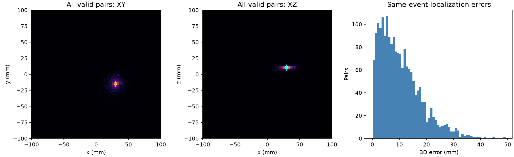

# PET 軟體驗證與第一階段研究結果

實驗日期：2026-10-19（Asia/Taipei）。本報告由 `scripts/build_report.py` 讀取實際輸出產生。

## 環境與驗證方法

本機使用新建並實際啟用的 Conda `pet-simulation` 環境。
Python：`3.11.17 | packaged by conda-forge | (main, Oct 13 2026, 16:36:10) [MSC v.1944 64 bit (AMD64)]`。
程式版本：`c5d3298a0c5c5f8fd6ebd3c3044163b2008f4189`；執行時工作目錄有變更：`False`。
完整程式 SHA-256、套件版本及輸出雜湊見 [manifest](synthetic_manifest.json)。

- 本機 pytest：**61 項通過**，原始紀錄見 [pytest.txt](pytest.txt)。
- Ruff 靜態檢查另以命令列執行；GitHub Actions 會重跑靜態檢查、測試與解析驗證。
- 獨立暴力 oracle：600 筆 Singles、218 組配對，與滑動視窗完全相同；打亂輸入順序仍相同。
- 零時間雜訊：1000 組真配對均找回，最大定位誤差 0.144409 mm，小於整數 ps 上限 0.149896 mm。
- 每端時間 σ=80 ps：實測定位 RMSE 16.957194 mm，理論值 16.958822 mm，相對差 0.0096%。

這些檢查驗證配對、單位、正負號、端點互換、量化與誤差傳播；沒有用 ground truth 建立配對。

## 理想幾何 Singles 實驗

設定 seed 20261019；7×48 detector、14 lane，最大絕對時間差 4000 ps、能量 350–650 keV、橫向角差至少 120°，全配對政策。

| 指標 | 實測結果 |
|---|---|
| 未配對 Singles | 15,871 |
| Coincidence pairs | 7,262 |
| 真配對 / 假配對 | 7,194 / 68 |
| 真配對比例 | 99.064% |
| 相鄰抵達資料的時間戳逆序次數 | 3,495 |
| 真正光源位置 mm | (20.000, -12.000, 12.000) |
| 有效真配對的重建平均位置 mm | (19.970, -12.050, 12.022) |
| 平均位置的三維偏差 | 0.0627 mm |
| 真配對單事件三維 RMSE | 16.9165 mm |
| 有效 / 非物理 TOF pairs | 7,243 / 19 |



圖中青色十字為已知光源。平均位置偏差與單一事件誤差需要分開解讀；平均值準確不代表單事件具有同等解析度。

## 時間同步誤差掃描

為隔離時鐘效應，本組實驗使用 4000 個幾何接受事件、100% 效率、無背景、10 kBq 條件接受事件率；x≥0 半環額外加入固定時間偏移。

| 每端時間 σ ps | 半環偏移 ps | 中心偏差 mm | 單事件 RMSE mm |
|---:|---:|---:|---:|
| 0 | 0 | 0.001 | 0.061 |
| 0 | 100 | 9.435 | 14.793 |
| 0 | 300 | 28.304 | 44.380 |
| 40 | 0 | 0.062 | 8.503 |
| 40 | 100 | 9.480 | 17.172 |
| 40 | 300 | 28.350 | 45.311 |
| 80 | 0 | 0.124 | 17.006 |
| 80 | 100 | 9.525 | 22.705 |
| 80 | 300 | 28.395 | 47.762 |
| 160 | 0 | 0.247 | 34.013 |
| 160 | 100 | 9.617 | 37.292 |
| 160 | 300 | 28.486 | 56.315 |

完整數字見 [timing_sweep.csv](timing_sweep.csv)。固定時鐘偏移可造成空間中心偏差；獨立零均值時間抖動主要增加事件定位分布的寬度。

## 真正的 OpenGATE / Geant4 實驗

OpenGATE 10.1.1，96 個 BGO 晶體、偏心點光源 (30.000, -15.000, 10.000) mm；Geant4 電磁傳輸後產生 Hits，再經 digitizer 產生尚未配對的 Singles。
實際產生 29,935 個事件，輸出 11,563 筆 Singles，Python 找到 1,921 組配對，其中 1,921 組屬於同一個模擬源事件。

EventID 相同不能證明未發生晶體散射，因此同事件比例是檢查指標，不是經完整 scatter/random 分類的 true-coincidence precision。
數值、ROOT branches、版本、設定及原始資料雜湊見 [metadata](gate_metadata.json)、[metrics](gate_metrics.json)。



重現指令（請在專案根目錄與已啟用的環境執行）：

```powershell
python scripts/generate_gate_singles.py --output data/raw/gate_demo --expected-events 30000 --activity-bq 200000.0 --source-mm 30.0 -15.0 10.0 --ctr-ps 200.0 --seed 20261019
pet-sim inspect-root data/raw/gate_demo/singles.root
pet-sim import-root data/raw/gate_demo/singles.root --tree Singles --mapping data/raw/gate_demo/mapping.json --out data/processed/gate_singles.csv
pet-sim run data/processed/gate_singles.csv --source-mm 30.0 -15.0 10.0 --out outputs/gate
```

既有 singles.root 不會覆寫；重新生成請更換 --output，並同步修改後續路徑。

有效同源事件配對的平均重建位置為 (29.907, -15.366, 9.947) mm；相對已知光源的中心偏差為 0.3815 mm，單事件三維 RMSE 為 12.7667 mm。這些值保留晶體散射與位置加總效應。

12 份必要物理資料的版本、官方來源、下載 helper 比對與 NDL 官方 MD5 校驗，見 [Geant4 資料驗證紀錄](geant4_verification.json)。

## 如何重現簡化流程

```powershell
. .\scripts\activate.ps1
New-Item -ItemType Directory -Force outputs | Out-Null
python -m pytest -q | Tee-Object outputs/pytest.txt
python -m pet_sim.cli validate
python -m pet_sim.cli demo
python -m pet_sim.cli sweep
python scripts/build_report.py
```

## 結論與下一步

已建立可重現、可檢查的離線 Singles → Coincidence → TOF-ROR 中心點累積流程。排序與配對通過獨立參考，TOF 計算符合解析量化及雜訊理論；時間偏移實驗提供後續同步研究的基準。

目前尚未實作有限寬度 ROR 核、MLEM/OSEM、完整 PET 校正及串流 reorder/watermark，也未量測 FPGA 吞吐量。本機原始 ROOT 與完整事件 CSV 保存在 data/ 與 outputs/；GitHub 保存程式、測試、文件與這份精簡證據。

研究模型與限制請一併閱讀 [README](../README.md) 及 [原始來源](../docs/sources.md)。
